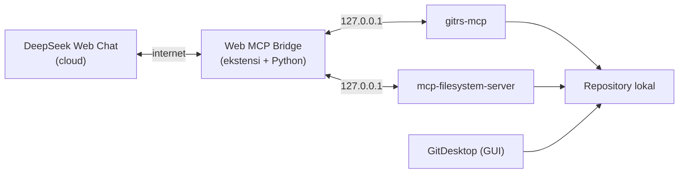

# Easy-Vibe

Implementasi arsitektur **vibe coding lokal** yang menghubungkan DeepSeek Web Chat ke tool MCP di komputer sendiri: membaca Git, mengedit file, dan mengelola commit.

> **Penting:** ini **bukan** sistem "100% lokal". AI tetap berjalan di cloud, dan prompt, potongan kode, diff, serta hasil tool dikirim ke DeepSeek. Yang lokal adalah penyimpanan, Git, dan eksekusi tool. Baca `docs/privasi.md`.

## Komponen

| Komponen | Peran |
|---|---|
| DeepSeek Web Chat | Analisis, perencanaan, penulisan kode (AI cloud) |
| Web MCP Bridge | Menghubungkan chat ke MCP lokal lewat WebSocket |
| gitrs-mcp | Status, diff, branch, staging, commit |
| mcp-filesystem-server | Baca/tulis file di direktori repo |
| GitDesktop | GUI manusia untuk review perubahan |

## Arsitektur



## Prasyarat

- Python 3.9+
- Go 1.21+ (untuk filesystem server)
- Git
- Chrome/Edge/Brave 116+
- GitDesktop (opsional, untuk review visual)

## Instalasi

### 1. gitrs-mcp

```bash
brew install prasenjit-net/tap/gitrs-mcp
```

Windows/Linux: gunakan installer dari halaman release gitrs-mcp.

### 2. mcp-filesystem-server

```bash
go install github.com/mark3labs/mcp-filesystem-server@latest
```

### 3. Web MCP Bridge

```bash
git clone https://github.com/AstraxOf/web-mcp-bridge
cd web-mcp-bridge
pip install -r server/requirements.txt
```

Muat folder proyek sebagai ekstensi unpacked di `chrome://extensions` (aktifkan Developer mode).

### 4. Konfigurasi server

Salin `config/bridge-servers.example.json` ke `web-mcp-bridge/server/servers.json`, lalu ganti path contoh dengan path repo Anda. Gunakan selalu garis miring `/`.

### 5. Jalankan bridge

```bash
python server/mcp_ws_bridge.py --config server/servers.json
```

### 6. DeepSeek

Buka `https://chat.deepseek.com`, buka panel Web MCP Bridge, klik **Inject instructions**. Gunakan isi `prompts/system-prompt-id.md` bila perlu menyuntikkan aturan secara manual. Biarkan izin pada **Ask every time**.

## Alur kerja

1. AI membaca status dan file yang relevan.
2. AI mengubah file lewat filesystem.
3. Manusia menjalankan pengujian.
4. AI membaca diff.
5. Manusia menyetujui staging dan commit.

Detail: `docs/alur-kerja.md`.

## Keamanan

- Batasi filesystem ke direktori repo saja.
- Jangan pernah mengirim kredensial, API key, atau `.env` ke chat.
- Aktifkan `--allow-write` gitrs hanya saat diperlukan.
- Setujui manual setiap operasi destruktif.
- Commit atau backup sebelum pekerjaan besar.

Checklist lengkap: `docs/keamanan.md`.

## Dokumentasi

- `docs/arsitektur.md` — alur data dan pembagian peran
- `docs/keamanan.md` — checklist dan model ancaman
- `docs/alur-kerja.md` — urutan kerja dan pola hemat payload
- `docs/privasi.md` — istilah yang akurat dan batas privasi
- `docs/risiko.md` — register risiko

## Lisensi

MIT
