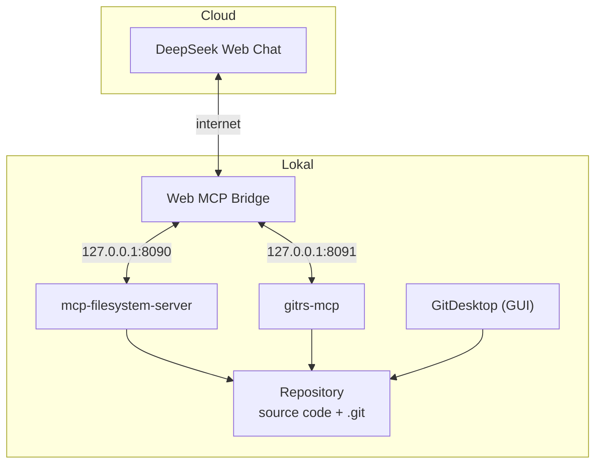

# Arsitektur

Dokumen ini menjelaskan alur data dan pembagian peran pada arsitektur vibe coding lokal Easy-Vibe.

## Prinsip dasar

1. **Tool lokal, AI cloud.** AI berjalan di DeepSeek Web Chat. Tool berjalan di komputer lokal melalui Web MCP Bridge.
2. **Pemisahan tugas.** Membaca Git, mengedit file, dan mengelola repositori adalah tiga tanggung jawab berbeda.
3. **Jumlah tool kecil.** Semakin sedikit server MCP aktif, semakin kecil konteks dan semakin kecil kemungkinan model bingung memilih tool.
4. **Manusia di titik keputusan.** Staging, commit, dan operasi destruktif memerlukan persetujuan manusia.

## Alur data

```
                 INTERNET
                     |
           DeepSeek Web Chat
                     |
             Prompt + kode
             + hasil MCP
                     |
                     v
             Web MCP Bridge
                     |
              Komputer lokal
                     |
             File dan Git lokal
```

Ketika DeepSeek membaca kode melalui filesystem MCP, hasil pembacaan dikirim kembali ke halaman chat. DeepSeek menerima hasil itu sebagai bagian dari percakapan. Karena itu, data yang dibaca tool **keluar dari komputer**.

## Diagram komponen



## Pembagian peran

| Komponen | Peran | Aktif di jalur default? |
|---|---|---|
| DeepSeek Web Chat | Analisis, perencanaan, instruksi, pembuatan kode (AI cloud) | Ya |
| Web MCP Bridge | Tool signature ringkas, izin, validasi pemanggilan | Ya |
| mcp-filesystem-server | Baca, tulis, modifikasi source code | Ya (dengan izin tulis) |
| gitrs-mcp | Status, diff, branch, staging, commit | Ya (izin tulis saat diperlukan) |
| GitDesktop (GUI) | Pemeriksaan visual oleh manusia | Ya (di luar MCP) |
| GitDesktop MCP | Info tambahan seperti PR atau CI | Tidak, aktifkan hanya bila perlu |

## Mengapa GitDesktop MCP tidak aktif secara default

gitrs-mcp dan GitDesktop MCP sama-sama menyediakan operasi baca Git. Menyalakan keduanya berarti model menerima dua cara untuk membaca informasi yang sama. Dampaknya:

- Jumlah tool bertambah dan konteks membesar.
- Model bisa bingung memilih tool.
- Ada risiko dua jalur tulis ke repository yang sama.

Karena itu GitDesktop dipakai sebagai GUI manusia. MCP GitDesktop hanya diaktifkan bila informasi yang dibutuhkan tidak tersedia di gitrs-mcp, misalnya status PR atau CI.

## Dua jalur tulis

```
DeepSeek
   |-- gitrs-mcp (--allow-write)
   |      -> reset, restore, stage, commit, branch
   |
   +-- mcp-filesystem
          -> write, modify, move, delete file
```

Keduanya dapat mengubah keadaan repository. Urutan kerja yang konsisten wajib dipakai agar perubahan tidak hilang. Lihat `alur-kerja.md`.

## Batasan yang perlu diingat

- Bridge bergantung pada format respons model dan struktur UI website. Perubahan di DeepSeek dapat mengganggu alur.
- Klaim penghematan token sekitar 50% adalah klaim pengembang, bukan benchmark independen. Penghematan deskripsi tool tidak otomatis menghemat seluruh konteks percakapan.
- Batas direktori pada filesystem MCP **bukan** sandbox keamanan mutlak. Proses MCP berjalan dengan hak akses sistem operasi yang meluncurkannya.
